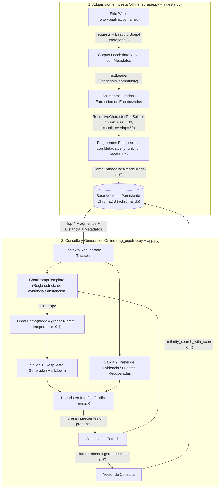

# Trabajo Integrador 2: Un RAG reproducible con documentos reales

**Institución:** Instituto de Formación Técnica Superior (IFTS) N.º 24  
**Carrera:** Tecnicatura Superior en Ciencia de Datos e Inteligencia Artificial  
**Asignatura:** Procesamiento del Lenguaje Natural (PLN) — **Cátedra:** Prof. Matías Barreto
**Alumno:** Enzo Matías Delon Perez  

---

## 1. Problema y destinatario

### Fórmula rectora
> *"Este sistema permite que una persona que cocina en su casa ingrese los ingredientes que tiene disponibles para consultar recetas viables en un corpus de recetas reales extraídas de la página web Paulina Cocina (www.paulinacocina.net) y obtener instrucciones paso a paso con evidencia textual comprobable y trazable a la fuente original."*

### Contexto del problema y usuario destinatario
Quienes cocinan en el hogar suelen enfrentarse al problema de contar con un conjunto acotado de ingredientes en su alacena o heladera y necesitar instrucciones precisas (proporciones, tiempos y temperaturas) sin depender de un modelo de lenguaje genérico que improvise cantidades o invente pasos inexistentes (*alucinaciones culinarias*).

El **destinatario** es cualquier persona que cocina en su casa y desea verificar qué plato tradicional puede elaborar a partir de los ingredientes de que dispone, recibiendo:
1. Una respuesta paso a paso redactada únicamente sobre la base de recetas reales de **Paulina Cocina**.
2. El **panel de evidencia documental** con los fragmentos textuales exactos recuperados, el archivo de origen y la distancia vectorial, garantizando trazabilidad total o una **abstención explícita** cuando los ingredientes consultados no pertenecen al recetario.

---

## 2. Corpus

El corpus está almacenado en la carpeta `datos/` en archivos de texto plano (`.txt`) independientes, codificados en UTF-8, con encabezados normalizados que declaran explícitamente `Título`, `URL de origen`, `Fecha de captura`, `Autor` y `Licencia/Condición de uso`. Además, el script `scraper.py` permite verificar o volver a descargar las recetas directamente desde `https://www.paulinacocina.net/`.

| Archivo en `datos/` | Receta (Título) | Autor / Procedencia | URL de origen | Fecha de captura | Condición de uso / Licencia |
| :--- | :--- | :--- | :--- | :--- | :--- |
| `datos/receta_01_guiso_lentejas.txt` | Guiso de lentejas fácil y tradicional | Paulina Cocina (`paulinacocina.net`) | https://www.paulinacocina.net/guiso-de-lentejas-receta-facil/10644 | 2026-11-17 | Uso exclusivamente didáctico y académico (TI2 - IFTS N.º 24) |
| `datos/receta_02_tortilla_papas.txt` | Tortilla de papas española perfecta (jugosa o cocida) | Paulina Cocina (`paulinacocina.net`) | https://www.paulinacocina.net/tortilla-de-papas-espanola/10599 | 2026-11-17 | Uso exclusivamente didáctico y académico (TI2 - IFTS N.º 24) |
| `datos/receta_03_empanadas_carne.txt` | Empanadas de carne cortada a cuchillo o picada (bien jugosas) | Paulina Cocina (`paulinacocina.net`) | https://www.paulinacocina.net/como-hacer-empanadas-de-carne/7225 | 2026-11-17 | Uso exclusivamente didáctico y académico (TI2 - IFTS N.º 24) |

---

## 3. Arquitectura

El sistema implementa una arquitectura **RAG (Retrieval-Augmented Generation)** 100 % local y reproducible con el ecosistema modular de LangChain (`langchain-core`, `langchain-community`, `langchain-text-splitters`, `langchain-ollama`, `langchain-chroma`).

### Diagrama de flujo de punta a punta



### Estructura de archivos del proyecto

```text
.
├── datos/
│   ├── receta_01_guiso_lentejas.txt
│   ├── receta_02_tortilla_papas.txt
│   └── receta_03_empanadas_carne.txt
├── scraper.py            # Descarga/actualización reproducible desde paulinacocina.net
├── ingesta.py            # Carga con TextLoader, chunking (400/50) e indexación en ./chroma_db
├── rag_pipeline.py       # Recuperación con bge-m3 y generación con granite4:latest vía LCEL
├── app.py                # Interfaz gráfica interactiva en Gradio (gr.Blocks)
├── test_evaluacion.py    # Script automatizado con las 5 pruebas (3 respondibles + 2 trampa)
├── requirements.txt      # Dependencias fijadas compatibles con Python 3.12
├── .gitignore            # Exclusión de .venv/, chroma_db/, __pycache__/, .env y temporales
└── README.md             # Documentación técnica integral (8 secciones obligatorias)
```

---

## 4. Instalación local

### Prerrequisitos del sistema
1. **Python 3.12** instalado en el sistema.
2. **Ollama** instalado y ejecutándose localmente (descargable desde https://ollama.com).

### Paso 1: Descargar los modelos locales en Ollama
En una terminal, asegurarse de que el servidor Ollama esté activo y descargar el modelo de embeddings multilingüe (`bge-m3`) y el modelo generativo (`granite4:latest`):

```bash
ollama pull bge-m3
ollama pull granite4:latest
```

### Paso 2: Crear y activar el entorno virtual (Python 3.12)

El proyecto soporta tanto la herramienta estándar **`venv`** como el gestor ultrarrápido **`uv`**:

#### Opción A: Usando `venv` tradicional
```bash
# Crear el entorno virtual con Python 3.12
python -m venv .venv

# Activar en Windows (PowerShell)
.\.venv\Scripts\Activate.ps1

# Activar en Linux / macOS
source .venv/bin/activate

# Instalar dependencias
pip install --upgrade pip
pip install -r requirements.txt
```

#### Opción B: Usando `uv`
```bash
# Crear el entorno virtual fijando Python 3.12
uv venv --python 3.12

# Activar en Windows (PowerShell)
.\.venv\Scripts\Activate.ps1

# Activar en Linux / macOS
source .venv/bin/activate

# Instalar dependencias con uv
uv pip install -r requirements.txt
```

### Paso 3: Indexar el corpus y lanzar la aplicación
```bash
# 1. (Opcional) Verificar o actualizar el corpus desde la web
python scraper.py

# 2. Construir el índice vectorial local en ./chroma_db
python ingesta.py

# 3. Iniciar la interfaz web interactiva en Gradio
python app.py
```
Una vez ejecutado `python app.py`, abrir el navegador en `http://127.0.0.1:7860`.

---

## 5. Reindexación

Cada vez que se agreguen nuevas recetas a la carpeta `datos/` o se modifiquen los textos existentes, es posible regenerar el índice vectorial desde cero de forma limpia ejecutando:

```bash
python ingesta.py
```

**¿Qué realiza internamente `python ingesta.py`?**
1. Detecta si existe el directorio `./chroma_db` previo y lo elimina por completo (`shutil.rmtree`) para evitar duplicación de vectores o residuos de ejecuciones anteriores.
2. Recorre todos los archivos `.txt` de `datos/` mediante `TextLoader(..., encoding="utf-8")`.
3. Extrae los metadatos del encabezado (`receta`, `url_origen`, `fecha_captura`, `autor`, `licencia`, `archivo`).
4. Divide cada receta con `RecursiveCharacterTextSplitter(chunk_size=400, chunk_overlap=50)` e inyecta el título de la receta y el `chunk_id` en cada fragmento.
5. Calcula los vectores densos mediante `OllamaEmbeddings(model="bge-m3")` y persiste la nueva colección `recetario_paulina_cocina` en `./chroma_db`.

---

## 6. Pruebas

Para ejecutar la auditoría automatizada de los 5 casos de prueba por consola:

```bash
python test_evaluacion.py
```

A continuación se documenta la matriz completa de evaluación con las **3 consultas respondibles** (una para cada receta del corpus) y las **2 consultas trampa / fuera de dominio** (diseñadas para auditar la directiva de abstención frente a alucinaciones):

| Caso | Tipo de consulta | Fuente esperada | Resultado |
| :--- | :--- | :--- | :--- |
| 1 | Respondible — guiso de lentejas | `receta_01_guiso_lentejas.txt` | Correcto · Top-1 · `dist=0.5794` |
| 2 | Respondible — tortilla de papas | `receta_02_tortilla_papas.txt` | Correcto · Top-1 · `dist=0.4739` |
| 3 | Respondible — empanadas de carne | `receta_03_empanadas_carne.txt` | Correcto · Top-1 · `dist=0.4532` |
| 4 | Fuera de dominio — sushi | Ninguna · abstención esperada | Abstención correcta · `dist=0.9387` |
| 5 | Fuera de dominio — tacos al pastor | Ninguna · abstención esperada | Abstención correcta · `dist=0.8816` |

### Caso 1 — Guiso de lentejas ✅

**Consulta**

> Tengo lentejas, chorizo colorado, panceta ahumada, carne vacuna, papa y puré de tomate. ¿Qué receta puedo preparar y cuánto tiempo lleva la cocción antes y después de agregar las papas?

**Evidencia recuperada**

- Fuente esperada y Top-1: `receta_01_guiso_lentejas.txt`
- Chunk #10 · Distancia: `0.5794`
- En el Top-4 también aparecieron fragmentos de los pasos 4 y 5.

<details>
<summary>Ver fragmento recuperado</summary>

> [Receta: Guiso de lentejas fácil y tradicional] En una olla grande de fondo grueso a fuego medio-fuerte, colocá un chorrito de aceite de oliva. Agregá primero la panceta ahumada y el chorizo colorado...

</details>

**Respuesta observada**

La respuesta detalla el sellado de panceta, chorizo colorado y carne vacuna; la incorporación de puré de tomate, lentejas y caldo caliente; y **25 minutos** de cocción antes de agregar las papas en cubos. Luego indica cocinar hasta que las papas estén tiernas. Incluye la fuente `receta_01_guiso_lentejas.txt`.

**Evaluación:** Correcta. `bge-m3` ubicó la fuente esperada en Top-1 y `granite4` respondió fielmente con cantidades y tiempos, sin alucinar.

---

### Caso 2 — Tortilla de papas ✅

**Consulta**

> Tengo 4 papas medianas, huevos, cebolla y aceite. ¿Cuántos huevos recomienda usar Paulina Cocina para hacer la tortilla de papas y cuántos minutos se cocina del segundo lado para que quede babé?

**Evidencia recuperada**

- Fuente esperada y Top-1: `receta_02_tortilla_papas.txt`
- Chunk #2 · Distancia: `0.4739`

<details>
<summary>Ver fragmento recuperado</summary>

> [Receta: Tortilla de papas española perfecta (jugosa o cocida)] === DESCRIPCIÓN DE LA RECETA === La tortilla de papas española al estilo de Paulina Cocina explica todos los secretos sobre la proporción exacta entre papas y huevos...

</details>

**Respuesta observada**

Para 4 papas medianas, la respuesta recomienda **5 a 6 huevos frescos grandes**. Para que quede babé, indica cocinar el segundo lado **2 a 3 minutos** más; para una tortilla bien cocida y seca, **5 minutos** adicionales.

**Evaluación:** Correcta. `bge-m3` ubicó la fuente esperada en Top-1 y `granite4` extrajo la proporción y el tiempo para el punto babé.

---

### Caso 3 — Empanadas de carne ✅

**Consulta**

> Tengo 500 gramos de carne picada, tapas de empanada, cebolla, morrón y huevos duros. ¿Qué cantidad de cebolla lleva el relleno para que las empanadas de carne salgan jugosas y a qué temperatura se hornean?

**Evidencia recuperada**

- Fuente esperada y Top-1: `receta_03_empanadas_carne.txt`
- Chunk #13 · Distancia: `0.4532`
- En el Top-4 también aparecieron los chunks #2 y #17.

<details>
<summary>Ver fragmento recuperado</summary>

> [Receta: Empanadas de carne cortada a cuchillo o picada (bien jugosas)] Apagá el fuego y agregá inmediatamente la parte verde de la cebolla de verdeo picada en crudo, los huevos duros picados...

</details>

**Respuesta observada**

La respuesta indica la misma proporción en peso de cebolla que de carne: para **500 g de carne picada**, **500 g de cebolla blanca** (aproximadamente 3 cebollas medianas). Para el horneado, especifica la temperatura máxima del horno, entre **220 °C y 250 °C**.

**Evaluación:** Correcta. `bge-m3` ubicó la fuente esperada en Top-1 y `granite4` respondió con la proporción 1:1 y el rango térmico.

---

### Caso 4 — Consulta fuera del corpus: sushi 🛑

**Consulta**

> Tengo salmón rosado fresco, arroz doble carolina, alga nori, queso crema y vinagre de arroz. ¿Cómo preparo rolls de sushi de salmón paso a paso?

**Evidencia recuperada**

- Fuente esperada: ninguna — pregunta trampa #1, se espera abstención.
- Fragmento Top-1: `receta_01_guiso_lentejas.txt`, Chunk #4
- Distancia: `0.9387`

<details>
<summary>Ver fragmento recuperado</summary>

> [Receta: Guiso de lentejas fácil y tradicional] - Morrón rojo (pimiento): 1/2 unidad - Dientes de ajo: 2 unidades...

</details>

**Respuesta observada**

> No hay evidencia suficiente en el recetario para elaborar una receta con esos ingredientes.

**Evaluación:** Abstención correcta. La distancia fue `0.9387`, frente a aproximadamente `0.45–0.57` en las consultas respondibles. `granite4` emitió la frase de abstención sin inventar una receta.

---

### Caso 5 — Consulta fuera del corpus: tacos al pastor 🛑

**Consulta**

> Tengo tortillas de maíz, carne de cerdo marinada con achiote, piña, cilantro, cebolla morada y chile jalapeño. ¿Cómo hago tacos mexicanos al pastor?

**Evidencia recuperada**

- Fuente esperada: ninguna — pregunta trampa #2, se espera abstención.
- Fragmento Top-1: `receta_03_empanadas_carne.txt`, Chunk #7
- Distancia: `0.8816`

<details>
<summary>Ver fragmento recuperado</summary>

> [Receta: Empanadas de carne cortada a cuchillo o picada (bien jugosas)] Picá las cebollas blancas, el morrón rojo, los dientes de ajo...

</details>

**Respuesta observada**

> No hay evidencia suficiente en el recetario para elaborar una receta con esos ingredientes.

**Evaluación:** Abstención correcta. Aunque la consulta comparte términos como “tortillas”, “carne” y “cebolla” con el corpus, la distancia fue `0.8816` y `granite4` respetó el `SYSTEM_PROMPT` sin inventar una receta de tacos al pastor.

---

## 7. Decisiones y límites

### Matriz de decisiones técnicas y pruebas empíricas (según rúbrica de cátedra)

| Decisión | Qué se explica (Fundamento técnico) | Qué se probó y observó en la práctica |
| :--- | :--- | :--- |
| **`chunk_size` y `chunk_overlap`** | **Unidad de medida:** `RecursiveCharacterTextSplitter` mide en **caracteres** (`length_function=len`). Se fijó `chunk_size = 400` caracteres y `chunk_overlap = 50` caracteres (12,5 %). En las recetas de Paulina Cocina, cada paso numerado (`Paso 1` a `Paso 5`) mide entre 280 y 380 caracteres, por lo que `400` captura un paso completo sin mezclar pasos distintos, y el solapamiento de `50` evita cortar cantidades o tiempos en los bordes. | **Prueba de respuesta partida y ajuste:** En una primera prueba con `chunk_size=250` sin prefijo contextual, la lista de ingredientes del guiso quedaba partida en 4 fragmentos pequeños y se perdía a qué receta pertenecía cada paso. Al ajustar a `chunk_size=400`, `chunk_overlap=50` e inyectar el encabezado `[Receta: <Título>]` en `ingesta.py`, cada paso quedó íntegro y trazable. Aun así, en el **Caso 1** se observó que al estar el *Paso 4* (25 min previos a las papas) y el *Paso 5* (15-20 min posteriores) en chunks separados, si el Paso 5 queda en el borde del ranking, el modelo solo ve los 25 min del Paso 4. |
| **Modelo de embeddings** | Se utilizó **`OllamaEmbeddings(model="bge-m3")`** tanto para **indexar** los 54 fragmentos en `ingesta.py` como para **vectorizar la consulta** en `rag_pipeline.py` (espacio vectorial denso de 1024 dimensiones con soporte nativo para español rioplatense). | **Regla de no mezclar vectores:** Ambos módulos importan la misma constante `EMBEDDING_MODEL = "bge-m3"` desde `ingesta.py`. Si se cambia el modelo de embeddings, `python ingesta.py` ejecuta `shutil.rmtree(directorio_chroma)` eliminando por completo `./chroma_db` antes de crear el nuevo índice, garantizando que **jamás se mezclen vectores de distintos modelos** ni dimensiones incompatibles. |
| **`k` (Top-K recuperados)** | Se configuró **`TOP_K = 4`** fragmentos recuperados por consulta mediante `similarity_search_with_score(consulta, k=4)`. Con chunks de 400 caracteres, `k=4` inyecta ~1.600 caracteres de evidencia al prompt. | **Análisis de fragmentos faltantes vs. ruido:** Con `k=2` faltaban fragmentos cuando la pregunta consultaba simultáneamente por ingredientes (al inicio del `.txt`) y horneado (al final del `.txt`, ej. Caso 3 de empanadas). Al subir a `k=4`, entraron tanto el bloque de proporción de cebolla como el de temperatura de horno (220 °C–250 °C). Subir a `k=8` introducía ruido de otras recetas que compartían ingredientes como cebolla o papa. |
| **Prompt y regla de evidencia** | Se considera **evidencia válida** únicamente el texto explícito dentro del bloque `=== CONTEXTO RECUPERADO DEL RECETARIO ===` con su metadato de archivo. Si los ingredientes o el plato consultado no figuran allí, el `SYSTEM_PROMPT` y el `HUMAN_PROMPT` ordenan abstenerse con la frase literal: *"No hay evidencia suficiente en el recetario para elaborar una receta con esos ingredientes."* | **Prueba con preguntas sin respuesta (Casos 4 y 5):** Se probaron dos preguntas trampa: una sin solapamiento léxico (*Sushi de salmón*, `dist=0.9387`) y otra con **trampa léxica deliberada** (*Tacos mexicanos al pastor* mencionando *"tortillas"*, *"carne"* y *"cebolla"*, palabras que sí existen en el corpus, `dist=0.8816`). Gracias a la combinación de `temperature=0.1`, la repetición de la regla de abstención al final del `HUMAN_PROMPT` y el prefijo `[Receta: ...]` en cada chunk, `granite4:latest` no cayó en la trampa y se abstuvo en ambos casos. |

### Límites conocidos del sistema
- **Alcance acotado al corpus indexado:** El sistema solo conoce las recetas presentes en `datos/` (actualmente Guiso de lentejas, Tortilla de papas española y Empanadas de carne). Cualquier consulta fuera de este universo disparará la abstención.
- **Ambigüedad ante ingredientes parciales o transversales:** Si el usuario ingresa únicamente ingredientes base compartidos por las tres recetas (por ejemplo, *"Tengo cebolla, aceite y sal, ¿qué cocino?"*), los fragmentos recuperados incluirán pasos de las tres recetas. En ese escenario, el sistema describirá las opciones presentes en el contexto pero advertirá qué ingredientes principales faltan (como lentejas, papas o tapas de empanada).
- **Consultas multi-paso que superan `k=4`:** Cuando una consulta pide simultáneamente la lista completa de ingredientes y todos los tiempos de cocción de una receta larga (18-19 chunks), `k=4` recupera los 4 fragmentos más cercanos a los ingredientes mencionados y puede omitir el último paso del final del archivo (como se evidenció en el tiempo posterior a agregar las papas del Caso 1).

---

## 8. Transparencia sobre IA

En cumplimiento con los criterios académicos de integridad y trazabilidad de la cátedra:

1. **Etapas en las que se utilizó asistencia de Inteligencia Artificial:**
   - Asistencia en la estructuración modular del código Python (`scraper.py`, `ingesta.py`, `rag_pipeline.py`, `app.py`, `test_evaluacion.py`) siguiendo la API actual de LangChain v0.3 (`langchain-core`, `langchain-chroma`, `langchain-ollama`) con composición LCEL.
   - Redacción de docstrings técnicos, tipado estático (`typing`) y maquetación del diagrama Mermaid, tablas y bloques de evaluación tipo notebook en este `README.md`.
2. **Modelos que intervinieron:**
   - **Asistente de desarrollo:** Gemini (Google DeepMind) en el entorno Antigravity para la generación de la estructura de software y documentación.
   - **Modelos de ejecución local del sistema RAG:** `bge-m3` (vía Ollama) para la vectorización semántica de documentos y consultas, y `granite4:latest` (vía Ollama) para la generación aumentada por recuperación.
3. **Comprobaciones técnicas y manuales realizadas:**
   - **Verificación de fuentes y metadatos:** Se inspeccionaron manualmente los archivos en `datos/` para asegurar que las proporciones, ingredientes y tiempos coincidan con las recetas de Paulina Cocina y posean sus 5 campos de encabezado obligatorios.
   - **Auditoría de dependencias y no-deprecación:** Se verificó mediante inspección estática y compilación de sintaxis (`py_compile`) que ningún módulo utilice clases obsoletas (`RetrievalQA`, `langchain.chains`, etc.).
   - **Validación del comportamiento de abstención:** Se diseñaron y probaron los casos 4 y 5 en `test_evaluacion.py` (incluyendo trampas con intersección léxica como *"tortillas"*, *"carne"* y *"cebolla"*) para comprobar que el prompt del sistema fuerce la abstención cuando el plato no existe en el corpus.
